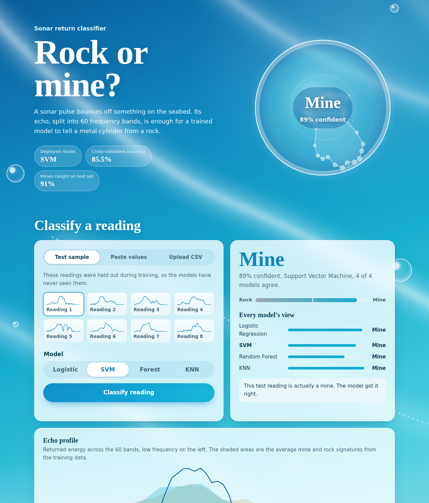
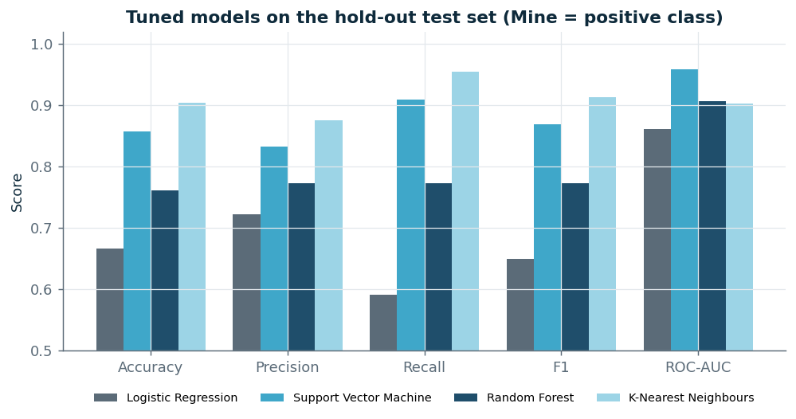
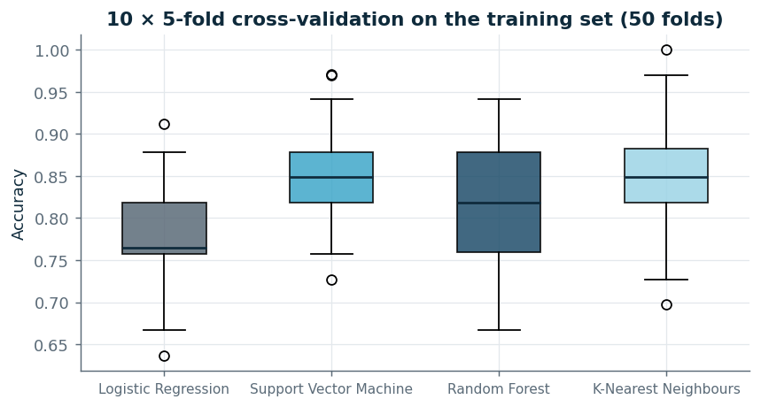

# Rock vs Mine Prediction

[](https://github.com/Bhoomirathi28/ROCK-VS-MINE-PREDICTION-/actions/workflows/ci.yml)


Sonar-based classification of underwater objects as **rocks** or **mines**, comparing four machine learning models and deploying the best one as a responsive, installable web app.



| | |
|---|---|
| **Dataset** | Gorman & Sejnowski sonar returns (UCI): 208 samples × 60 frequency bands |
| **Models** | Logistic Regression, Support Vector Machine, Random Forest, K-Nearest Neighbours |
| **Deployed** | SVM (RBF kernel, C = 5, γ = 0.01) — 85.5 % cross-validated accuracy, 85.7 % test accuracy, ROC-AUC 0.959 |
| **Live app** | _add your Render URL here after deploying (see [docs/DEPLOYMENT.md](docs/DEPLOYMENT.md))_ |
| **Interface** | Flask REST API + responsive web UI, installable as a PWA on Android, iOS, Windows, macOS and Linux |
| **Team** | Bhoomi Rathi (B4-56), Anandi Bhute (B3-38), Tanishka Mohod (B4-51) — ML Lab, A5, 5th semester |

---

## Results

All metrics treat **Mine as the positive class**, because a missed mine is far more dangerous than a false alarm. Test set: 42 held-out readings (22 mines, 20 rocks).

| Model | CV accuracy (10×5 fold) | Test accuracy | Precision | Recall | F1 | ROC-AUC | Mines missed |
|---|---|---|---|---|---|---|---|
| Logistic Regression | 0.775 ± 0.054 | 0.667 | 0.722 | 0.591 | 0.650 | 0.861 | 9 / 22 |
| **SVM (deployed)** | **0.855 ± 0.051** | **0.857** | **0.833** | **0.909** | **0.870** | **0.959** | **2 / 22** |
| Random Forest | 0.820 ± 0.071 | 0.762 | 0.773 | 0.773 | 0.773 | 0.907 | 5 / 22 |
| K-Nearest Neighbours | 0.851 ± 0.062 | 0.905 | 0.875 | 0.955 | 0.913 | 0.902 | 1 / 22 |

**Why SVM and not KNN, when KNN scored higher on the test set?** The deployed model is chosen on cross-validated accuracy (50 folds on the training data), not on the 42-row test set. One test sample is worth 2.4 percentage points, so the 0.905 vs 0.857 gap is two readings. SVM has the higher, more stable CV score and the best ROC-AUC, meaning its probabilities rank mines above rocks most reliably. Tuned KNN uses k = 1, which memorises the training set (100 % train accuracy) and gives only 0/1 confidence values.

Baseline (original notebook) vs tuned pipeline:

| Model | Notebook baseline | Tuned pipeline |
|---|---|---|
| Logistic Regression | 0.690 | 0.667 |
| SVM | 0.786 | **0.857** |
| Random Forest | 0.810 | 0.762 |
| KNN | 0.810 | **0.905** |

<p float="left">
  
  
</p>

All figures are in [`reports/figures/`](reports/figures) and all raw numbers in [`reports/metrics/`](reports/metrics).

---

## Project structure

```
rock-vs-mine-prediction/
├── app/                        # 3. UI deployment
│   ├── app.py                  #    Flask server + REST API
│   ├── templates/index.html    #    responsive interface
│   └── static/                 #    CSS, JS, PWA manifest, service worker, icons
├── data/
│   ├── raw/sonar_data.csv      #    original dataset
│   ├── sample_readings.csv     #    6 test rows to try the CSV upload
│   └── processed/              #    stratified train.csv / test.csv
├── docs/                       # 4. report guide, viva prep, deployment guide, screenshots
├── models/                     #    trained .joblib pipelines + model_meta.json
├── notebooks/                  #    original Colab notebook
├── reports/
│   ├── figures/                # 2. 12 analysis charts
│   └── metrics/                #    data_audit.json, model_comparison.csv, cv_scores.csv
├── src/                        # 1 & 2. data pipeline and modelling
│   ├── config.py               #    paths, seed, split size
│   ├── data_preprocessing.py   #    load → audit → clean → split
│   ├── models.py               #    baseline + tuned model definitions
│   ├── evaluate.py             #    metrics, timing, repeated CV
│   ├── visualize.py            #    all report figures
│   ├── train.py                #    end-to-end training script
│   └── predict.py              #    inference class + CLI
├── tests/                      # 4. 24 automated tests (data, models, API)
├── .github/workflows/ci.yml    #    tests on Ubuntu, Windows and macOS on every push
├── Dockerfile, Procfile, render.yaml, runtime.txt
├── requirements.txt, requirements-dev.txt, Makefile, .flake8
└── LICENSE
```

---

## Quick start

Requires Python 3.11 or newer (3.12 recommended; pinned numpy and pandas versions need 3.11+).

```bash
git clone https://github.com/Bhoomirathi28/ROCK-VS-MINE-PREDICTION-.git
cd ROCK-VS-MINE-PREDICTION-

python -m venv .venv
source .venv/bin/activate          # Windows: .venv\Scripts\activate
pip install -r requirements-dev.txt

python app/app.py                  # open http://localhost:5000
```

Trained models are committed, so the app starts straight away. To reproduce everything from the raw CSV:

```bash
python -m src.train                # cleans data, trains 4 models, writes metrics + figures (~1 min)
pytest -q                          # 24 tests
```

Command-line prediction:

```bash
python -m src.predict --values "0.0307,0.0523,...,0.0055"     # 60 values
python -m src.predict --csv data/sample_readings.csv --model knn
```

---

## Pipeline

**1. Data cleaning and splitting** (`src/data_preprocessing.py`)
The raw file is audited before anything changes: missing values, duplicates, values outside the valid 0–1 range, invalid labels and IQR outliers. The audit found the dataset already clean (0 issues). The cleaning rules still run every time, so any future data is handled, and a unit test injects dirty rows to prove they work. The 325 IQR outlier cells are kept: they are physically valid strong echoes, and removing them from 208 samples would discard real signal. The data is split 80/20 with stratification (`random_state=1`, identical to the notebook), giving 166 training and 42 test readings with the same 53/47 mine-to-rock ratio.

**2. Model comparison** (`src/train.py`)
Each model is trained twice: once exactly as in the notebook (baseline), once as a tuned pipeline. Standard scaling lives inside the pipeline so it is fitted only on training folds, which prevents data leakage. Hyper-parameters are chosen with 5-fold `GridSearchCV`, then each tuned model is scored with 10 × 5-fold repeated stratified CV and once on the untouched test set. Reported metrics: accuracy, precision, recall, specificity, F1, ROC-AUC, confusion matrix, overfitting gap, training time and prediction latency.

**3. Deployment** (`app/`)
A Flask server loads all four models once and exposes them through a JSON API. The interface lets you classify held-out test readings, pasted values or an uploaded CSV, switch between models, and see every model's vote. See [docs/DEPLOYMENT.md](docs/DEPLOYMENT.md).

---

## REST API

| Method | Endpoint | Body / response |
|---|---|---|
| GET | `/api/health` | `{"status": "ok", "model": "svm"}` |
| GET | `/api/models` | metrics and hyper-parameters of all four models |
| GET | `/api/samples` | 8 held-out test readings and the per-class mean signatures |
| POST | `/api/predict` | `{"features": [60 floats], "model": "svm"}` → label, probabilities, all-model votes |
| POST | `/api/predict/batch` | `{"readings": [[60 floats], ...]}` → one result per row (max 500) |

```bash
curl -X POST http://localhost:5000/api/predict \
  -H "Content-Type: application/json" \
  -d '{"features": [0.02, 0.0371, ...60 values...], "model": "svm"}'
```

The API sends CORS headers, so a mobile app or any other front end can call it directly.

---

## Cross-platform access

| Platform | How |
|---|---|
| Any browser (desktop, phone, tablet) | Open the deployed URL; layout adapts from 320 px to wide screens, light and dark mode |
| Android / Chrome / Edge | Menu → *Install app* — runs in its own window with an icon |
| iPhone / iPad | Safari → Share → *Add to Home Screen* |
| Phone on the same Wi-Fi | Run `python app/app.py`, then open `http://<laptop-ip>:5000` |
| Any OS with Docker | `docker build -t rock-vs-mine . && docker run -p 5000:5000 rock-vs-mine` |
| Scripts / other apps | REST API above, or `python -m src.predict` |

CI runs the full retrain and test-suite on Ubuntu, Windows and macOS on every push.

---

## Dataset

Gorman, R. P., & Sejnowski, T. J. (1988). Analysis of hidden units in a layered network trained to classify sonar targets. *Neural Networks*, 1(1), 75–89. Available from the UCI Machine Learning Repository as "Connectionist Bench (Sonar, Mines vs. Rocks)".

## License

MIT — see [LICENSE](LICENSE).
